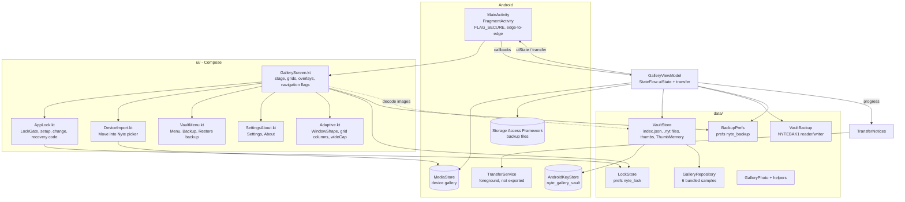

# 2. Architecture

## 2.1 Shape of the app

The app has a single activity, uses Jetpack Compose and keeps state in one `AndroidViewModel`. It has no navigation
library. Screens and overlays are shown or hidden by `remember { mutableStateOf(...) }` flags inside the
`GalleryScreen` composable. The only Android component besides the activity is a foreground `Service`, used for
long transfers.



## 2.2 Source files

All Kotlin sources are under `app/src/main/java/com/nytefall/nytegallery/`. Line counts are from the current commit.

| File | Lines | Responsibility |
|---|---:|---|
| `MainActivity.kt` | 67 | Entry point. Sets `FLAG_SECURE` (unless `SCREENSHOTS_ALLOWED`), enables edge-to-edge with transparent bars, and provides `LocalHostActivity`. Creates `GalleryViewModel`, collects `uiState` and `transfer`, and wires every `GalleryScreen` callback to a ViewModel method. |
| `TransferService.kt` | 131 | `TransferService` (foreground service) and the `TransferNotices` singleton that starts, updates and stops it. |
| `data/GalleryPhoto.kt` | 60 | `GalleryPhoto` data class, `stamp()`, `formatTaken()`, `yearOf()`, `captureMillis()` (EXIF date). |
| `data/GalleryRepository.kt` | 14 | The 6 bundled sample photos (`valley`, `japan`, `cyber`, `sea`, `cat`, `lantern`). |
| `data/VaultStore.kt` | 555 | Encrypted storage: `index.json`, `.nyt` photo files, encrypted thumbnails, Keystore key, decode/sampling, trash purge, `ThumbMemory` LRU cache, `ThumbGate` per-file locks. |
| `data/VaultBackup.kt` | 301 | `NYTEBAK1` backup format: writer, streaming reader, verify, and a hand-written PBKDF2-HMAC-SHA256. |
| `data/LockStore.kt` | 301 | App-lock settings: method set, PBKDF2 hashes, wrong-try cooldown, recovery code, migrations. |
| `data/BackupPrefs.kt` | 29 | `guide_seen`, `last_backup_at`, `last_backup_photos`. |
| `ui/GalleryViewModel.kt` | 757 | All state and long-running work: carousel rotation, rename, trash, import, removal of originals, export, backup write/verify/read, transfer progress. |
| `ui/GalleryScreen.kt` | 2427 | The main composable: stage (carousel), grid, trash grid, full view, every overlay, back handling, permission and SAF launchers, toasts. |
| `ui/AppLock.kt` | 1048 | `LockGate`, `LockSetupPage`, `LockChangePage`, `RecoveryCodeSettingsPage`, `RecoveryCodePage`, pattern pad, `LockConfirm`, `LockTries`. |
| `ui/DeviceImport.kt` | 363 | Runtime permission list per Android version, MediaStore query, the "Move into Nyte" picker (All / Folder). |
| `ui/VaultMenu.kt` | 519 | Side menu, Backup page and first-time guide, "Backup saved" page, Restore backup page. |
| `ui/SettingsAbout.kt` | 395 | Settings page (Recycle bin, Clear cache, lock, recovery code, backup), About page, feedback mail and policy links. |
| `ui/Adaptive.kt` | 28 | `WindowShape` (Phone / TallWide / Landscape), `vaultGridColumns()`, `Modifier.wideCap()`. |
| `ui/theme/Theme.kt` | 23 | `SAOGalleryTheme`, a Material 3 `darkColorScheme` (Crimson `#E10600`, Night `#120308`). Most screens choose their own colours instead of reading the theme (see [UI](07-ui.md)). |

Resources: `res/drawable/` holds the 6 sample JPEGs, the launcher art and the adaptive icon layers.
`res/drawable-nodpi/` holds `bg_dark.jpg` and `bg_light.jpg`, the stage backgrounds. `res/xml/` holds the backup
and data-extraction exclusion rules. `res/values/` holds the strings (`app_name`), colours and the platform theme
`Theme.SAOGallery` (`android:Theme.Material.NoActionBar`, background `#FF120308`).

> The names `SAOGallery` / `SAOGalleryTheme` are left over from the project's earlier name. The repo folder and
> theme still use them. Only the package and applicationId were renamed, to `com.nytefall.nytegallery`.

## 2.3 State flow

```
VaultStore.load() ──► all: MutableStateFlow<List<GalleryPhoto>>   (vault + trash, one list)
                      rotation: MutableStateFlow<Float>            (carousel angle in degrees)
          combine(all, rotation) ──► uiState: StateFlow<GalleryUiState>
                                         photos      = all.filter { trashedAt == null }
                                         trash       = all.filter { trashedAt != null }
                                         rotation    = angle
                                         activeIndex = floorMod(round(angle / (360/count)), count)
_transfer: MutableStateFlow<TransferProgress?> ──► transfer (shown as TransferDialog + notification)
```

- `uiState` uses `SharingStarted.WhileSubscribed(5_000)`. `MainActivity` collects it with `collectAsState()`.
- Every change goes through `update(id) { ... }` or replaces `all.value`, then calls `vault.save(list)`, which
  rewrites `index.json` in place (`writeText`, not atomic; see [Limitations D1](09-limitations-todo.md)). Persistence is therefore immediate, and there is no separate save step.
- **Startup work in `init`** (on `Dispatchers.IO`): if a photo has `takenAt == 0`, its date is backfilled from EXIF,
  and the index is saved if anything changed. After a 2-second delay, `ensureThumb()` runs for every vault photo,
  which creates any missing v2 thumbnails.
- **Only one transfer at a time.** `openTransfer()` returns `false` while `transferring` is true. Import, export and
  restore then quietly do nothing. Verify reports "Another task is still running. Try again when it finishes".

### Carousel maths (ViewModel side)

- One step is `360 / count` degrees. When a drag starts, `dragOrigin` is recorded. While dragging,
  `rotation = rotation - deltaPx * step / 150` (`PIXELS_PER_CARD = 150`), clamped to `dragOrigin ± step`, so one drag
  moves at most one card.
- When the drag ends, the carousel snaps one step in the drag direction if it moved more than half a step, and
  otherwise snaps back. The fling velocity is passed in but not used.
- `animateTo()` is a 480 ms cubic ease-out (`1 - (1 - t)^3`) driven by a coroutine with `delay(16)` frames.
- `showIndex(i)` animates if the target is at most one step away, and jumps straight there otherwise.

## 2.4 Data classes

| Class | Fields | Notes |
|---|---|---|
| `GalleryPhoto` | `id: String`, `name: String`, `imageRes: Int = 0`, `vaultFile: String? = null`, `trashedAt: Long? = null`, `takenAt: Long = 0L` | `imageRes != 0` means a bundled sample. `vaultFile` is the `<id>.nyt` file name. |
| `GalleryUiState` | `photos`, `trash`, `rotation`, `activeIndex` | Derived from the state above. |
| `TransferProgress` | `label`, `done`, `total` | `total <= 0` means indeterminate. |
| `ImportOutcome` | `imported` | Moves the user to the remove/keep sheet if `imported > 0`. |
| `RemovalOutcome` | `consent: IntentSender?`, `alreadyRemoved: Boolean` | Result of starting "Remove originals". |
| `DeleteStep` | `Consent(sender)`, `Done`, `Failed` | The next delete-consent batch on Android 11+. |
| `BackupOutcome` | `saved`, `left`, `problem`, `fileName` | |
| `VerifyOutcome` | `photos`, `problem` | |
| `RestoreOutcome` | `added`, `skipped`, `problem`, `failed` | |
| `VaultBackup.Entry` | `id`, `name`, `takenAt`, `trashedAt`, `bytes` | One photo inside a backup. |
| `VaultBackup.ReadResult` | `Ok(added)`, `BadPassword`, `NotBackup`, `Damaged(added)` | |

### Helpers in `GalleryPhoto.kt`

- `stamp()`: the current time in milliseconds.
- `formatTaken(ms)`: builds the text by hand from `Calendar` (device time zone) and an English `MONTHS` array, with a lowercase am/pm (for example
  `3 November 2026, 9:41am`). Returns an empty string for 0.
- `yearOf(ms)`: the year, shown in the card header.
- `captureMillis(stream)`: reads the EXIF `DateTimeOriginal`, falling back to `DateTime`.
  EXIF has no time zone, so the date is parsed in the device's default time zone.

## 2.5 MainActivity

1. If `!SCREENSHOTS_ALLOWED` (in `ui/GalleryScreen.kt`, read from `BuildConfig.SCREENSHOTS_ALLOWED`: **`false`** except in the `screenshot` build type), it calls
   `window.setFlags(FLAG_SECURE, FLAG_SECURE)` before `setContent`.
2. It calls `enableEdgeToEdge()` with transparent status and navigation bars.
3. It provides `LocalHostActivity` (a `FragmentActivity`), which `BiometricPrompt` and the intent-sender launchers
   need.
4. The manifest declares
   `configChanges="orientation|screenSize|smallestScreenSize|screenLayout|keyboardHidden"`. Rotating or resizing the
   window therefore **does not recreate** the activity. Compose recomposes with the new size, and all `remember`
   state, including the lock state, survives.

## 2.6 TransferService and TransferNotices

`TransferNotices.show(context, progress)` is called on every progress update:

- On the first call it creates the notification channel `nyte_transfer` ("Vault transfer", `IMPORTANCE_LOW`) and
  starts `TransferService` with `startForegroundService`.
- On later calls it updates notification `7101`, with text "`X of Y`" or "Working" and a determinate or
  indeterminate progress bar. The notification is ongoing and silent, and opens `MainActivity` when tapped. On
  API 31+ it uses `FOREGROUND_SERVICE_IMMEDIATE`.

`TransferService.onStartCommand` calls `startForeground` with the type `MEDIA_PROCESSING` on API 35+, `DATA_SYNC` on
API 29–34, and no type below 29. It returns `START_NOT_STICKY`, and `onTimeout` stops it. `TransferNotices.hide()`
sends the `STOP_TRANSFER` action, so the service calls `stopForeground(REMOVE)` and `stopSelf()`.

**Purpose:** the work itself runs in `viewModelScope` coroutines inside the app process. The service only keeps the
process at foreground priority, so a long import, backup or restore keeps going after the user presses Home. If the
process is killed anyway, the transfer is lost (`START_NOT_STICKY`), and nothing resumes it. Each item is saved as it
finishes, so finished items remain.

If notification permission is denied on Android 13+, the service still runs, but its notification isn't visible.
**(not verified on a device)**

## 2.7 Unused or legacy code

- `GalleryViewModel.addPicked(items)` is not called anywhere (dead code from an earlier "pick with system picker"
  flow).
- `VaultStore.LEGACY_NAMES` (in its companion object) maps the original Indonesian sample names to English names. `VaultStore.load()`
  uses it to rename samples in an older `index.json`.
- `LockStore` still reads, and then deletes, the legacy keys `email`, `code`, `code_at` and `salt` from the removed
  email-recovery feature (see [App lock](04-app-lock.md)).
