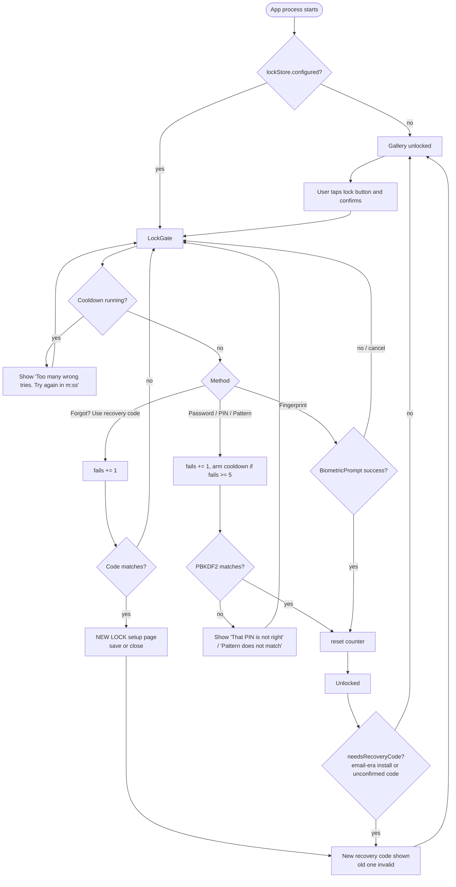

# 4. App lock

Code: `data/LockStore.kt` (storage, hashing, cooldown) and `ui/AppLock.kt` (screens). It is wired up in
`ui/GalleryScreen.kt`.

## 4.1 What the lock is, and what it is not

- The lock is optional. It is off on a fresh install.
- It is a **UI gate**. When `locked` is true, `LockGate` covers the whole screen, and every other page (menu, backup,
  settings, about, full view, import picker, remove-originals sheet) is hidden or closed.
- It is **not a cryptographic binding**. The vault key in the Keystore doesn't need user authentication (see
  [Storage §3.3](03-storage-encryption.md#33-encryption-of-photos)). The photos are encrypted at rest whether or not
  the lock is on. The lock stops someone who has the unlocked phone from browsing the app. It doesn't protect the
  photos from someone who could run code as the app.
- **When the app locks:**
  - on start, `locked` starts as `lockStore.configured()`, so every new process (cold start) begins locked;
  - when the user taps the lock button (top-left) and confirms "Lock Nyte Gallery now?";
  - right after a new lock is set up, once the user has confirmed the new recovery code.
- **Auto-lock** (`ui/AutoLock.kt`, `AutoLockEffect` in `GalleryScreen`). It applies only when a lock is set, the
  app isn't already locked, and no recovery reset is in progress:
  - **Leaving the app (`ON_STOP`):** the app locks once it has been away for **3 s** (`AutoLock.GRACE_MS`). A timer
    locks it while it's in the background, and `ON_START` checks again. Coming back within 3 s doesn't lock, which
    avoids flicker. A configuration-change stop is ignored.
  - **While a new recovery code is on screen** (`RecoveryCodePage`), the time away is **60 s**
    (`AutoLock.RECOVERY_GRACE_MS`) instead of 3 s, so the code can be copied into a notes app and the user can come
    back. The grace is read when the app leaves the foreground. Screen off still locks at once.
  - **Screen off (`ACTION_SCREEN_OFF`, registered at runtime):** locks at once.
  - **Exception:** stopping within 5 s of the app opening a system screen it waits on doesn't lock. These are
    marked with `AutoLock.expectExternal()`: permission requests, the delete consent, the SAF create/open document
    pickers, the fingerprint prompt, and the feedback email and policy links. The mark is cleared on the next
    `ON_START`. If the screen turns off while the user is in such a screen (after those 5 s), the app still
    locks.
  - Locking only sets `locked = true`, so the lock screen is drawn over everything. A running import, export or
    backup (`TransferService`) carries on, and its results arrive behind the lock. The in-app photo picker is part
    of the app, so leaving from it counts as leaving the app.
  - There's no setting for it.

## 4.2 Unlock methods and the "2 or more" rule

| Method | Rule at setup | How it's checked |
|---|---|---|
| Password | 6 or more characters, typed twice | PBKDF2 hash compare |
| PIN | 4–6 digits (`\d{4,6}`), typed twice; the field accepts digits only, up to 6 | PBKDF2 hash compare |
| Pattern | 3×3 pad, at least 4 dots, drawn twice to confirm. Stored as the dot indices joined with `-` (for example `0-1-2-5`) | PBKDF2 hash compare |
| Fingerprint | Shown only if `canAuthenticate(BIOMETRIC_STRONG)` (Class 3) is available or not enrolled. Turned on after one successful `BiometricPrompt` ("Confirm fingerprint") | `BiometricPrompt` with `setAllowedAuthenticators(BIOMETRIC_STRONG)`. No `CryptoObject`. |

- `LockSetupPage` shows "**N of 2 ways set**". The save button only works when **2 or more** methods are set ("Set at
  least two unlock ways"). This protects against forgetting a single secret.
- Fingerprint is **strong-only** (Class 3), so weak (Class 2) face unlock can't pass.
- If fingerprint was saved but the phone has no usable strong biometric now (none enrolled, hardware unavailable,
  or the device only has weak biometrics), the lock screen and "Confirm it's you" hide that method
  (`usableMethods`). The other saved ways and the recovery code still unlock. Because of the 2-way rule there's
  always at least one other way.
- On the lock screen the default method is the first saved method that isn't fingerprint. The others appear as chips
  when more than one is saved. The order comes from a `StringSet` in prefs, so it isn't guaranteed.
- Fingerprint doesn't prompt automatically. The user taps "Use fingerprint".

## 4.3 LockStore storage

SharedPreferences file `nyte_lock` (app-private, excluded from backup):

| Key | Type | Meaning |
|---|---|---|
| `on` | bool | Lock configured |
| `methods` | string set | Any of `password`, `pin`, `pattern`, `finger` |
| `password`, `pin`, `pattern` | string | Hash of each secret (see 4.4) |
| `recovery` | string | PBKDF2 hash of the recovery code |
| `recovery_saved` | bool | The user ticked "I have written down my recovery code" |
| `recovery_pending` | string | The unconfirmed recovery code, AES-256-GCM encrypted with the non-exportable Keystore key `nyte_recovery_pending`, stored as `<iv base64>:<ciphertext base64>`. Deleted on Continue, or by `clear()`. |
| `fails` | int | Wrong tries in a row, shared by all methods and the recovery code |
| `wait_ms` | long | Length of the current cooldown |
| `wait_until_elapsed`, `wait_start_elapsed` | long | Cooldown end and start on the `elapsedRealtime` clock |
| `wait_until_wall`, `wait_start_wall` | long | Cooldown end and start on the wall clock |
| `wait_boot` | int | `Settings.Global.BOOT_COUNT` when the cooldown was anchored |
| `salt` | string | **Legacy:** install-wide salt for the old SHA-256 format |
| `email`, `code`, `code_at` | | **Legacy:** removed email recovery. Read only to detect old installs, then deleted. |

## 4.4 Hash format and migration

New format, used for every secret and for the recovery code:

```
pbkdf2$210000$<salt: 16 random bytes, hex>$<PBKDF2-HMAC-SHA256 output, 32 bytes, hex>
```

- `PBKDF2WithHmacSHA256` through `SecretKeyFactory`, with 210,000 iterations (`PBKDF2_ITERATIONS`) and a fresh
  salt per secret.
- The iteration count is stored in each hash, so it can be raised later without breaking old hashes.
- Comparison is constant-time (`MessageDigest.isEqual`).
- The `PBEKeySpec` password and the char array are cleared after use.
- Hashing is slow, so `check`, `checkRecovery`, `save` and `newRecoveryCode` run on `Dispatchers.Default`, never
  on the main thread.

**Migration from the old format:** older installs stored `hex(SHA-256("<salt>:<value>"))` with one install-wide
`salt`. `matches()` still accepts that format, and after the first successful match it re-saves that secret in the
PBKDF2 format. Nobody is locked out by the upgrade. Each secret upgrades separately when it's first used.

## 4.5 Wrong tries and cooldown

**Empty input is never checked or counted.** Tapping Unlock or Continue with nothing typed shows "Enter your PIN",
"Enter your password" or "Enter your recovery code" (a recovery code of only dashes or spaces counts as empty). As a
backstop, `check()` and `checkRecovery()` return `Wrong(0)` for an empty value (or `Wait` if a cooldown runs) without
saving a try or running PBKDF2. Background: PBKDF2 on Android (BouncyCastle) throws `IllegalArgumentException:
password empty`, which used to crash the app. `LockTries.attempt` also catches any exception from a check and shows
"Couldn't check that. Please try again." instead of crashing.

**Passwords are trimmed** at setup and at unlock, so leading or trailing spaces never matter.

Otherwise `check()` and `checkRecovery()` go through `guarded()`:

1. If a cooldown is running, the call returns `Wait(remaining)` **without checking** the value.
2. Otherwise `fails + 1` is **saved first** (with `commit()`), and any cooldown due for that count is armed. Killing
   the app during the slow check can't skip a counted try.
3. The value is checked. A match resets everything and returns `Ok`. A mismatch returns `Wrong(wait)`.

| Wrong tries in a row | Cooldown after that try |
|---|---|
| 1–4 | none |
| 5 | 30 s |
| 6 | 1 min |
| 7 | 5 min |
| 8 | 15 min |
| 9 | 30 min |
| 10 and above | 1 h each |

- The counter is shared by password, PIN, pattern and the recovery code. It survives restarts because it's kept in
  prefs.
- A fingerprint success calls `noteSuccess()`, which resets the counter. Fingerprint failures aren't counted by the
  app, because the system prompt has its own lockout.
- **Resistance to clock changes** (`waitRemainingMs`):
  - **Same boot** (same `BOOT_COUNT`, and `elapsedRealtime` hasn't gone backwards): only the monotonic
    `elapsedRealtime` is used, so changing the wall clock has no effect.
  - **After a reboot:** the wall clock is used. The remaining time is clamped to `[0, full]`. If the clock is set
    to before the cooldown started, the **full** cooldown restarts. The result is then re-anchored to the new
    boot's `elapsedRealtime`.
- The UI (`LockTries`) ticks the countdown once a second and shows
  "Too many wrong tries. Try again in m:ss." (or `h:mm:ss` from 1 hour up). While the countdown runs, the Unlock and
  Continue buttons do nothing.

## 4.6 Recovery code

| Property | Value |
|---|---|
| Alphabet | `ABCDEFGHJKMNPQRSTUVWXYZ23456789`: 31 symbols, without 0/O and 1/I/L |
| Length | 16 characters, from `SecureRandom`, about 79 bits |
| Display format | `XXXX-XXXX-XXXX-XXXX` |
| Storage | PBKDF2 hash (same format as 4.4). Until it's confirmed, the plain code is also kept encrypted with a Keystore AES-GCM key (`recovery_pending`), so it can be shown again. After Continue only the hash is left. |
| Check | Input is uppercased and stripped to letters and digits, so case, dashes and spaces don't matter. The input field allows up to 24 characters. |
| Wrong tries | Shares the counter and cooldown described above |

**Creating a code** (`newRecoveryCode`) replaces any old code, sets `recovery_saved = false`, stores the encrypted
pending copy (if the Keystore fails, no copy is kept) and deletes the legacy `email`, `code` and `code_at` keys.

**`pendingRecoveryCode()`** decrypts the pending copy and returns it only if it still matches the saved hash. If it
can't be decrypted or doesn't match, the copy is deleted and null is returned.

**`RecoveryCodePage`** shows the code once:
- It shows `RECOVERY_WARNING`: "Write this code down and keep it somewhere safe. It is the ONLY way back in if you
  forget your unlock methods. Nyte Gallery cannot recover it for you. If you lose it and forget your lock, your
  photos cannot be opened."
- **Copy** puts the code on the clipboard. On API 33+ the clip is marked `EXTRA_IS_SENSITIVE`, so the system doesn't
  preview it. After 60 s the clipboard is cleared if it still holds the code (best effort, since Android 10+ may
  block clipboard reads from the background).
- **Continue** works only after ticking "I have written down my recovery code". It then calls
  `markRecoverySaved()`, which also deletes the pending copy. The page has **no Close** button, and Back is blocked
  while it's open.
- If the app locks while the page is open, the page is hidden behind the lock screen and comes back with the same code
  after unlocking.

**When a code is shown:**
1. Right after the first lock setup. After Continue, the app locks itself.
2. After a recovery-code unlock (see the flow below).
3. From Settings, Recovery code: the user confirms with a current lock method (the recovery code isn't offered
   there), then "Create new recovery code".
4. Automatically after unlocking, when `needsRecoveryCode()` is true, meaning the lock is on but there is no code or
   it was never confirmed:
   - **Old email-recovery installs** (`email` key present) see: "Nyte Gallery no longer uses email to recover your
     lock. It now uses a recovery code that never leaves this phone. Your old recovery email has been removed."
   - **An unconfirmed code with a pending copy** (for example the app was killed or crashed on the code page) shows
     the **same** code again with the note "Not confirmed yet. This is the same code as before."
   - **An unconfirmed code without a pending copy** (Keystore failure, or an install from before this change) gets a
     new code: "Your recovery code was not confirmed, so here is a new one. The old one no longer works."
   - Settings, Recovery code and the recovery-code unlock still create a **new** code on purpose, which replaces any
     pending one.

**Using the code:** on the lock screen, "Forgot? Use recovery code" appears only if a code exists. A correct code
calls `onRecovered`. The app unlocks and opens **NEW LOCK** (`LockSetupPage`): "You used your recovery code. Choose
at least two new ways to get back in…". Saving replaces the methods. Closing keeps the old methods. **Either way**, a
new recovery code is created and shown, and the old one stops working. The old code isn't consumed when it's used.
It stays valid until the new one is created, so killing the app in the middle can't lock the user out.

## 4.7 Unlock flow



## 4.8 Manage lock and turn off

From Settings, Security:

- When the lock is **off**: "App lock: Off · Tap to set up a lock" opens the same confirm and setup path as the lock
  button. "Recovery code: Created when you set up the lock" also starts setup.
- **Manage lock: "On · Add, change or remove ways to unlock"** (`ManageLockPage`):
  1. `CurrentLockCheck` "MANAGE LOCK": confirm with one current method. The recovery code isn't offered here, and the
     same wrong-try counter applies.
  2. One card per way (Password, PIN, Pattern, Fingerprint), each with an **On/Off** pill:
     - **Off:** "Add". **On:** "Change" (not for fingerprint) and "Remove".
     - Add and Change open the same input as setup for that one way, with the same rules (password 6+ characters,
       PIN 4–6 digits, pattern 4+ dots drawn twice). Fingerprint is added after one `BIOMETRIC_STRONG` prompt. It's
       offered only when strong biometrics are available ("Fingerprint is not available on this phone." otherwise).
       A saved fingerprint on a phone without usable strong biometrics can still be removed.
     - Remove asks "Remove PIN as a way to unlock Nyte Gallery?" (Cancel / Remove). When only 2 ways are on,
       Remove is dimmed and the page shows "Keep at least 2 ways to unlock".
     - Saving uses `LockStore.setMethod(method, value)` (PBKDF2, 210k) and `removeMethod(method)`, which refuses to go
       below `MIN_METHODS = 2`. **Other ways and the recovery code aren't touched.**
  3. Each change is committed on its own, so auto-lock (normal rules) can close the page without losing a saved
     change.
- **Turn off lock** (red row, only shown when the lock is on; `TurnOffLockPage`):
  1. `CurrentLockCheck` "TURN OFF LOCK".
  2. Warning **TURN OFF LOCK**: "Anyone with this phone can open Nyte Gallery. Your recovery code will stop working.
     Photos stay encrypted." (Cancel / Turn off).
  3. Turn off runs `LockStore.clear()`, which deletes **all** lock prefs: every way, the recovery code, any pending
     code and the try counter. Toast: "App lock is off". Encryption doesn't change, because the vault key isn't tied
     to the lock. Turning the lock on again gives a new recovery code.
- **Recovery code** (`RecoveryCodeSettingsPage`): check the current lock, then "Create new recovery code".

## 4.9 FLAG_SECURE, screenshots and Recents

- `SCREENSHOTS_ALLOWED` is an `internal val` in `ui/GalleryScreen.kt`, read from `BuildConfig.SCREENSHOTS_ALLOWED`.
  It's **`false`** in debug and release, and `true` only in the separate `screenshot` build type. `MainActivity`
  reads it before `setContent`, so the very first frame is already protected. A `DisposableEffect` in `GalleryScreen`
  adds or clears the flag again.
- With `FLAG_SECURE` on, for the whole app including the lock screen:
  - screenshots and screen recordings show black or are refused;
  - the app's preview in **Recent apps** is blank;
  - casting or mirroring the screen to non-secure displays shows black.
- For Play Store screenshots, use the `screenshot` build type (CI artifact `nyte-gallery-screenshots-apk`; see
  [Build §8.2](08-build-release.md#screenshot-build-play-store-listing-screenshots)). Don't change the default.
