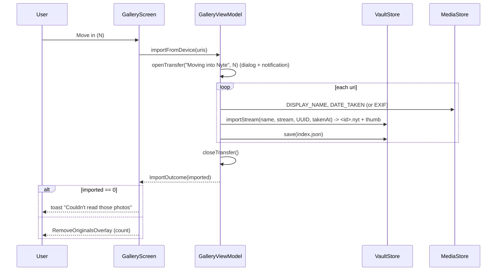

# 5. Import from the device, and restore to the device

Code: `ui/DeviceImport.kt` (permissions, query, picker), `GalleryViewModel.importFromDevice`, `removeOriginals`,
`keepOriginals`, `nextDeleteStep`, `exportToPublic`, and the wiring in `GalleryScreen.kt`.

## 5.1 Photo permissions per Android version

`photoPermissions()`:

| Android | API | Requested |
|---|---|---|
| 14+ | ≥ 34 | `READ_MEDIA_IMAGES` + `READ_MEDIA_VISUAL_USER_SELECTED` |
| 13 | 33 | `READ_MEDIA_IMAGES` |
| 10–12L | 29–32 | `READ_EXTERNAL_STORAGE` |
| 8.0–9 | 26–28 | `READ_EXTERNAL_STORAGE` + `WRITE_EXTERNAL_STORAGE` |

- `hasPhotoAccess()` is true if **any** of those is granted. On Android 14, "Select photos" (partial access) counts,
  and the picker then lists only the photos the user allowed.
- "Add Images" (green button, or the "+" tile in the grid) opens the picker straight away if access exists.
  Otherwise it requests the permissions. If none is granted, a toast says: "Photo access is needed to move images
  out of your gallery".
- The app doesn't use the system Photo Picker (`ACTION_PICK_IMAGES`). It lists MediaStore itself.

## 5.2 The "Move into Nyte" picker (`DeviceImportPage`)

- Queries `MediaStore.Images.Media.EXTERNAL_CONTENT_URI` for `_ID`, `DISPLAY_NAME` and `bucket_display_name`,
  sorted by `DATE_ADDED DESC`, and stops at **4,000** photos. If the bucket column isn't supported, it queries again
  without folders. Photos with no bucket are grouped under "Pictures".
- Intro text: "Chosen photos are encrypted into Nyte Gallery. Afterwards you are asked whether to remove the
  originals from your phone gallery or keep them." (Matches the remove/keep choice in 5.4.)
- Modes:
  - **All**: one grid of every photo (`vaultGridColumns()`).
  - **Folder**: folder tiles (2 columns on phones, `Adaptive(160.dp)` otherwise) showing a cover thumbnail, the
    folder name, the photo count and a pink badge with how many are selected. Tapping a folder opens its photos.
    "‹ Folder" or Back returns to the folder list.
- "Select all" / "Clear" applies to the current scope (all photos, or the open folder). Selection survives switching
  modes.
- Thumbnails: `ContentResolver.loadThumbnail(uri, 240×240)` on API 29+, otherwise `BitmapFactory` with
  `inSampleSize = 4`.
- The bottom button reads "Select photos" (disabled) or "**Move in (N)**". Tapping it closes the picker, opens the
  grid view and starts the import.

## 5.3 Import flow

- Name: `DISPLAY_NAME` without its extension, or "Photo".
- Date: MediaStore `DATE_TAKEN`, then EXIF `DateTimeOriginal`/`DateTime`, then the current time.
- Each photo is saved to the index **as soon as it's encrypted**. An interrupted import keeps every photo that
  finished.
- After the import, the carousel turns to the first new photo (`showIndex(start)`).
- The URIs of the photos that imported successfully are kept in `pendingOriginals`. **Nothing has been deleted from
  the device at this point.**

## 5.4 Remove or keep originals (`RemoveOriginalsOverlay`)

This sheet is shown when `originalsToAsk > 0`, the app isn't locked, and no transfer is running. Content:

- A green check, then the title "1 photo is now safe in Nyte Gallery" or "N photos are now safe in Nyte Gallery".
- "They're encrypted and only open with your lock." **(This is shown even when no app lock is set.)**
- "The original copies are still in your phone's gallery, where anyone can see them. Remove them so these photos
  are only in Nyte Gallery?"
- On Android 11+ only: "Android will ask you to confirm on the next screen."
- Buttons:
  - **Remove originals** (pink);
  - **Keep originals** (outlined). Toast: "Originals kept in your gallery". This clears `pendingOriginals`, so
    nothing is ever deleted.
- **Back**, or tapping the dimmed area outside the sheet, acts as Keep originals.

### Delete behaviour per Android version (`planRemoval`)

| Android | What happens on "Remove originals" |
|---|---|
| **11+ (API 30+)** | URIs are split into batches of **20** (`DELETE_BATCH`). `MediaStore.createDeleteRequest` opens the system confirm dialog for the first batch. Each `RESULT_OK` leads to `nextDeleteStep()`, which launches the next batch until the queue is empty. Then the toast "Encrypted inside Nyte Gallery and removed from your gallery" shows. If the user cancels any batch, the queue is cleared and the toast "Saved in Nyte Gallery. Any photo you did not confirm is still in your other gallery" shows. If building a request throws, the toast is "Saved in Nyte Gallery, but still visible in your other gallery". |
| **10 (API 29)** | `resolver.delete(uri)` is tried for each URI. Photos the app doesn't own throw `RecoverableSecurityException`. Its `userAction` intent sender is launched for **that one photo**, and the loop **stops there**. See the gap below. |
| **8.0–9 (API 26–28)** | `resolver.delete(uri)` runs straight away with the legacy `WRITE_EXTERNAL_STORAGE` grant. There is no system dialog. If every delete returns more than 0, the toast is "Encrypted inside Nyte Gallery and removed from your gallery". Otherwise it's "…but still visible in your other gallery". |

**Android 10 gap (known issue):** after the user allows the `RecoverableSecurityException` dialog, the result handler
calls `nextDeleteStep()`. The queue is empty on Android 10, so it returns `Done`, and the success toast shows. The
delete is **not retried**, so the photo the user approved may still be in the gallery. Any photos after the first one
that threw were never attempted. On Android 10, removal is therefore unreliable, and the success message can be
wrong. See [Limitations](09-limitations-todo.md).

## 5.5 Restore to the device ("Restore" / export)

The "Restore" button (bottom-left, or in the landscape side panel) opens `RestorePage`. Text: "Restoring writes
these photos back onto this phone, in Pictures/Nyte Gallery. Other apps can open them, and they leave Nyte Gallery."

- A grid with multi-select (green tick). Buttons: "**Restore Selected**" and "**Restore All**". "Select all" /
  "Clear" sits in the header. Only non-trashed photos are listed.
- On Android 9 and below, `WRITE_EXTERNAL_STORAGE` is requested first. If it's denied, the toast is "Storage
  permission is needed to restore photos".
- `exportToPublic(ids)` runs as a transfer ("Restoring photos", with progress). For each photo, `writePublic`:
  1. Inserts a MediaStore image row with `DISPLAY_NAME = "<safe name>-<first 6 chars of id>.jpg"`. The safe name
     keeps only `[A-Za-z0-9 _-]`, up to 40 characters, or uses "Nyte". `MIME_TYPE = image/jpeg`.
  2. On API 29+ it also sets `RELATIVE_PATH = Pictures/Nyte Gallery` and `IS_PENDING = 1`.
  3. Streams the decrypted original bytes into the file (`copyPlain`, GCM-verified). Bundled samples are written as
     JPEG at quality 92.
  4. Clears `IS_PENDING` on API 29+. If anything fails, the row is deleted.
  5. **Only if the write succeeded** is the photo removed from the index and its vault files deleted.
- Toast: "Restored to Pictures/Nyte Gallery", or "Couldn't restore those photos" if nothing was exported.

Notes and unclear points:
- The original bytes are written unchanged, but the name always ends in `.jpg` and the MIME type is always
  `image/jpeg`. A PNG or HEIC that was imported comes back with a `.jpg` name. **(Viewers usually sniff the real
  format, but this is not verified.)**
- On Android 9 and below, `RELATIVE_PATH` isn't set, so the file goes wherever MediaStore puts new images by
  default (usually the root `Pictures/` folder, not a `Nyte Gallery` sub-folder). The toast still says
  "Pictures/Nyte Gallery". **(not verified on a device)**
